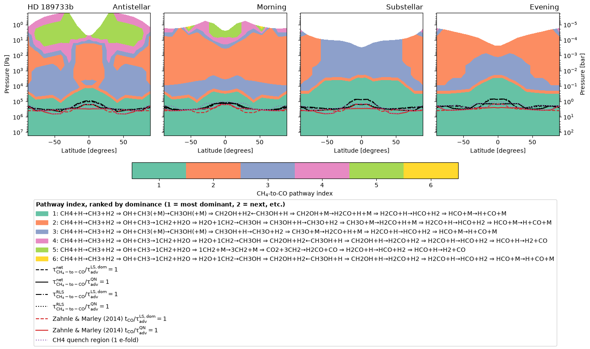

# quenchpath

Chemical pathway analysis for hot Jupiter atmospheres: given a General
Circulation Model (Unified Model) run's 3D wind/temperature/composition
fields and the Venot et al. (2019) reduced chemical network, quenchpath
finds the dominant reaction pathway converting CH4 to CO (or, via
`--conversion co_ch4`, CO to CH4) at every grid location, and the
pathway and advection timescales whose crossing sets the quench level.

## Example output



The dominant CH4-to-CO pathway at every grid location for HD 189733b,
at four representative longitudes - one colour per distinct reaction
chain, each spelled out in full in the legend - with the quench levels
where the pathway and advection timescales cross drawn on top, plus a
comparison against Zahnle & Marley (2014)'s literature quench
timescale.

Everything in it comes from the bundled `inputs/example_data/`, so
`notebooks/plt_slices.ipynb` reproduces it with no pipeline run of your
own; `python scripts/generate_example_figure.py` regenerates the image
itself.

## Install

```
pip install -e .[dev]
```

Needs `scitools-iris`, `aeolus`, `networkx`, `numpy`, `cf-units`,
`pandas`, `stratify`, `click` (all in `pyproject.toml`'s `dependencies`).
`dev` extras (`pytest`, `ruff`) are only needed for running the test suite/
linter; `viz` (`pip install -e .[viz]`) adds matplotlib/pyyaml for
`quenchpath.viz`.

## Quickstart

```
quenchpath read-polynomials       # stage 01, network-wide, once
quenchpath read-network            # stage 02, network-wide, once
quenchpath run-pipeline-serial --planet hd189733b --exp kin
    # stages 03-07 chained for one planet/exp, SAMPLE resolution
```

See `docs/user_guide.md` for the full command reference (every stage,
`--grid-resolution`/`--conversion`, file layout), external-data setup,
notebooks, the bundled example dataset, and plotting. See
`docs/uni_vs_bidirectional_pathway_search.md` for how the CH4-to-CO vs
CO-to-CH4 pathway search decides which reaction-network graph to use.

## Testing

```
pytest
ruff check .
```

Tests are fixture-based (tiny synthetic or sliced-real-data fixtures under
`tests/data/`, no multi-GB UM files) so they run fast in CI on every push -
see `tests/conftest.py` and `.github/workflows/tests.yml`.

## Citing

If you use quenchpath, please cite Zamyatina et al. (2026, MNRAS,
accepted) and the software itself - see `CITATION.cff`, or GitHub's
"Cite this repository" button.

The bundled Venot et al. (2019) reduced chemical network
(`inputs/raw_networks/venot2019/`) is taken from the KIDA database
(https://kida.astrochem-tools.org) and is not covered by this
repository's MIT licence; please cite Venot et al. (2019) if you use it.
